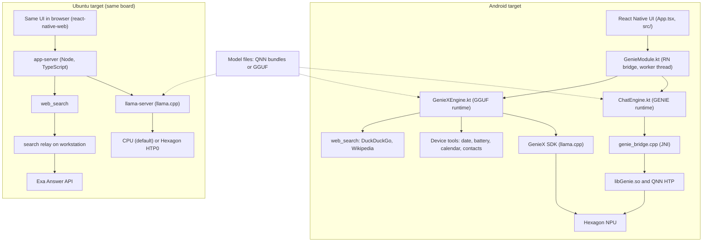

# LLM-Deployment: on-device LLM chat on a Qualcomm NPU

A React Native chat app and deployment pipeline that runs small LLMs on the Hexagon NPU of a Qualcomm QCS8550 board, on Android and on Ubuntu.

**Five on-device models · Two NPU runtimes (QNN Genie and GenieX/llama.cpp) · Tool calling with web search · Android and Ubuntu targets**

## Why

Running the model on the device keeps prompts and chat history local and removes a network round trip from every reply. The hard part this repo works through is making that run on a Qualcomm NPU: exporting models to the QNN format, working around DSP memory limits, and bringing up two different on-device runtimes on the same chip. The app's only network use is the `web_search` tool, which sends the query string the model chose and nothing else.

## Features

- **Chat with five models.** Llama 3.2 1B and 3B, Qwen3 4B (QNN/Genie context binaries), and Qwen3.5 2B and Gemma 4 E2B (GGUF through GenieX). Only one model is resident at a time, and a chat stays pinned to the model it started with.
- **Multiple persisted chats** with streamed replies. Chats and settings are stored on the device.
- **Per-chat toggles** for brief answers and reasoning. Reasoning is shown behind a disclosure, separate from the answer.
- **Tool calling** (Qwen3.5 2B only). Tools are date and time, battery, device info, and web search. On Android the app also has calendar query and contacts search, which need runtime permissions.
- **Ubuntu target.** The same React Native UI runs in a browser on the board, served by a Node app-server that wraps llama.cpp. Messages typed while a reply is generating are queued.
- **Image attachment UI** exists on Android, but the GenieX engine currently declines images (see Ongoing work).
- **Debug tooling.** A host-side adb CLI and a model-switch stress harness work with debug builds.

## Architecture



Both targets share the React Native screens and components in `genie-on-device/app-rn/src/`. On Android the UI calls a native module. On Ubuntu the same UI talks to the app-server over HTTP with server-sent events, through a `.web.ts` module that replaces the native one.

### Models

| Model | Runtime | Context (Android / Ubuntu) | Reasoning | Tools |
|---|---|---|---|---|
| Llama 3.2 1B Instruct | GENIE (QNN) | 4096 / not on Ubuntu | no | no |
| Llama 3.2 3B Instruct | GENIE (QNN) | 2048 / not on Ubuntu | no | no |
| Qwen3 4B | GENIE (QNN) | 512 / not on Ubuntu | yes | no |
| Qwen3.5 2B | GenieX (GGUF) | 164,000 / 8192 | yes | yes |
| Gemma 4 E2B | GenieX (GGUF) | 32,768 / 8192 | yes | no |

Values are from `ModelStore.kt` (Android) and `server/models.ts` (Ubuntu). The Ubuntu context values are described in the docs as conservative and pending measurement. The Ubuntu target supports only the two GGUF models.

## Engineering highlights

- **Two runtimes on one chip.** GENIE models run as QNN context binaries produced by Qualcomm AI Hub cloud compilation. A JNI bridge (`genie_bridge.cpp`) holds a `GenieDialog` open, so the KV cache survives between turns and each turn prefills only the new text. GGUF models run through GenieX's llama.cpp backend, which applies the model's own chat template.
- **Process restart instead of in-process model swaps.** On Android, every in-process swap raced the DSP teardown and failed in several ways. Restarting the process fixed this. `docs/ANDROID-RN-APP.md` reports 60 of 60 switches with no reboots in stress runs. On Ubuntu, `llama-server` runs as a separate process, so a switch is a respawn.
- **Context budgeting for a small window.** Genie does not reject an over-long prompt; it silently truncates the reply. The app therefore enforces the budget itself: the reply reserve scales with the window, old turns are trimmed, and the newest turn is truncated if needed. `ChatEngineContextTest` checks every window size with brevity and reasoning on and off. `docs/README.md` records that Qwen3 4B loads on this chip only at context 512 (4096 and 1024 fail at load with `err 1002`).
- **Tool calls without trusting the model's format.** On Android, a tolerant parser extracts `<tool_call>` blocks, the loop is capped at four iterations, and the last pass drops the tools so the model must answer. On Ubuntu the app moved to llama-server's OpenAI-compatible endpoint, which returns structured `tool_calls`, so the hand-written parser was removed.
- **Measured CPU vs NPU for decode.** On the Ubuntu target, `llama-bench` on Qwen3.5-2B-Q4_0 measured decode at 21.6 tok/s on CPU and 7.0 tok/s on the Hexagon HTP0 backend, while prefill favoured HTP0 (164.5 vs 101.5 tok/s). CPU is therefore the default, and `LLAMA_DEVICE=HTP0` switches it (`docs/UBUNTU-BOARD.md` section 4.1).
- **Board-specific packaging issues.** Model files on FUSE-backed external storage cannot be mapped into the DSP, so the app copies them to internal storage before loading. The APK keeps `extractNativeLibs` on so the DSP skeleton libraries are real files, and it pins one consistent set of QAIRT libraries.

## Tech stack

- **Android app:** Kotlin 1.9.22, C++ JNI (CMake, NDK 26.1.10909125), Android Gradle, minSdk 27, targetSdk 34, JUnit 4 unit tests.
- **UI:** React Native 0.74.5, React 18.2, TypeScript, AsyncStorage. Browser build with react-native-web and webpack, tested with Jest and jsdom.
- **Inference:** Qualcomm QAIRT (Genie C API, QNN HTP), GenieX Android SDK 0.3.12, llama.cpp (`llama-server`) with the Hexagon backend on Ubuntu.
- **Model pipeline:** Qualcomm AI Hub cloud compilation through `qai-hub-models`, run in a Docker image with Python 3.10 on Ubuntu 22.04. Orchestration is in bash, plus a Python debug CLI.
- **Ubuntu app-server:** Node 20 and TypeScript, with no runtime dependencies so it runs on a board without network access.
- **Web search:** Exa Answer API, with DuckDuckGo Instant Answer and Wikipedia as keyless fallbacks. Android uses only the keyless pair.

## Repository layout

```
LLM-Deployment/
  .gitignore                    excludes model weights, build output, workspace outputs and secrets
  .claude/                      Claude Code project notes and a condensed deployment runbook
  genie-on-device/
    INDEX.md                    entry point: doc map, fast path, script reference
    docs/                       architecture, usage, reproduction and board notes, with findings
    docker/Dockerfile           Python 3.10 toolchain for the AI Hub export
    scripts/                    export pipeline: build image, configure hub, export, push models
    workspace/deploy/           pre-built GENIE deploy configs (large binaries are gitignored)
    app-rn/                     the chat app
      App.tsx, src/             shared UI: chat list, chat screen, composer, store, theme
      android/                  Android project: Kotlin engines, tools, JNI bridge, unit tests
      server/                   Ubuntu app-server: llama-server supervisor, tool loop, web search
      web/                      react-native-web entry, webpack config, render and interaction tests
      scripts/                  deploy.sh (Android), deploy-linux.sh (Ubuntu), search relay, debug CLI
      handoffs/                 root-cause write-ups for device bring-up and runtime bugs
```

## Building and running

### Android (QCS8550 devkit, Android 13)

Requirements, as documented in `genie-on-device/app-rn/README.md`:

- Node 20 (documented; `package.json` declares `>=18`), JDK 17, Android SDK, and NDK 26.1.10909125.
- `adb` with exactly one device attached.
- The QAIRT runtime libraries are already committed under `android/app/src/main/jniLibs/`, so a fresh clone builds without the QAIRT SDK.

```bash
cd genie-on-device/app-rn
npm install
bash scripts/deploy.sh --models gguf   # bundle JS, build and install APK, push GGUF models
```

The GGUF models are not in the repo. Download a Q4_0 quant and place it under `genie-on-device/workspace/gguf/<model-id>/`:

- `qwen3_5_2b`: `Qwen3.5-2B-Q4_0.gguf` and `mmproj-F16.gguf` (the vision projector, which the current GenieX build cannot load).
- `gemma4_e2b`: `gemma-4-E2B-it-Q4_0.gguf` (the repo records `unsloth/gemma-4-E2B-it-GGUF` on Hugging Face as a working source).

GENIE models are cloud-compiled automatically by `deploy.sh` when their bundle is missing. This needs Docker, an AI Hub API token (`AI_HUB_API_TOKEN`), and for `llama_v3_2_3b_instruct_ctx2048`, an `HF_TOKEN` with access to the gated Meta repository. The docs say the first compile per model takes about an hour.

```bash
bash scripts/deploy.sh --models all                       # every model
bash scripts/deploy.sh --skip-build --models gemma4_e2b   # push only
```

For UI iteration, run `npx react-native start` and `cd android && ./gradlew installDebug`. Debug builds include the adb CLI (`scripts/genie_cli.py`).

### Ubuntu (same board, Ubuntu 22.04)

```bash
cd genie-on-device/app-rn
bash scripts/deploy-linux.sh --models gguf   # cross-build llama.cpp, bundle UI, push, start
node scripts/search-relay.mjs 8079           # optional, on the workstation, for web_search
```

The script builds llama.cpp for arm64 Linux against a Jammy sysroot, bundles a Node 20 runtime, pushes it with the models, and sets up the adb port forwards. `web_search` needs an `EXA_API_KEY`, which is read from the environment or from a gitignored `secrets.txt` on the workstation. The UI is then served on port 8080 through the adb forward.

### Tests and checks

- `./gradlew testDebugUnitTest` in `app-rn/android` runs the context-budget unit tests (7 `@Test` methods).
- `npm run test:web` builds the browser bundle and checks rendering and interactions in jsdom.
- `npm --prefix server run build` typechecks the Ubuntu app-server.

## Ongoing work

- **Voice input.** Dictation is listed as still open in `docs/ANDROID-RN-APP.md`, and it needs a native QNN runner and Whisper detokenizer. The earlier Whisper and Llama voice assistant and chatbot CLI (`scripts/07_chatbot.py`, `docs/CHATBOT.md`) exist only on `origin/debug`. The earlier Kotlin/Views app (`android/`, package `com.qcs.geniechat`) is also only there.
- **Image input.** `GenieXEngine.kt` declines image attachments because the GenieX VLM path crashes on this device (`HANDOFF-qwen-vision.md`). The GenieX AAR 0.3.12 also cannot load the Qwen3.5 vision projector (`qwen3vl_merger`), as noted in `app-rn/android/app/build.gradle`.
- **Web search on Android.** Exa is wired into the Ubuntu server only (commits `0b97f05` and `c4db648`). The Android `WebSearchTool.kt` still uses DuckDuckGo and Wikipedia.
- **Ubuntu target.** Context is set to 8192 pending measurement. The rendered UI has not been checked on a real screen, and there is no systemd unit, so the server does not survive a board reboot (`docs/UBUNTU-BOARD.md`, section 9).
- **Deleting models.** Staged or pushed bundles cannot be removed from inside the Android app, and each model takes several GB of storage.
